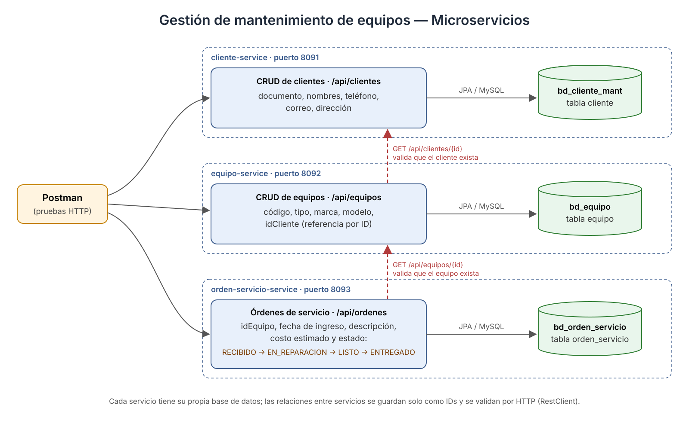

# Evaluación 03 – Laboratorio 08: Gestión de mantenimiento de equipos

Desarrollo de Aplicaciones Web (Tecsup) · Microservicios con Spring Boot, Spring Data JPA y MySQL.

Un centro técnico controla **clientes**, **equipos** y **órdenes de servicio**. Cada parte es un microservicio independiente, con su propio puerto y su propia base de datos.



## Requisitos

- Java 25 (JDK)
- Maven (se incluye `mvnw` en cada servicio)
- MySQL 8 en `localhost:3306` (usuario `root` en desarrollo)
- Postman para las pruebas

## Microservicios

| Servicio | Puerto | Base de datos | Ruta base |
|---|---|---|---|
| `cliente-service` | 8091 | `bd_cliente_mant` | `/api/clientes` |
| `equipo-service` | 8092 | `bd_equipo` | `/api/equipos` |
| `orden-servicio-service` | 8093 | `bd_orden_servicio` | `/api/ordenes` |

> La guía sugiere `bd_cliente`. Se usó `bd_cliente_mant` porque en el equipo de trabajo ya existía una base `bd_cliente` de otro laboratorio con otra tabla `cliente`.

Las referencias entre servicios se guardan solo como IDs (`idCliente`, `idEquipo`). Antes de guardar, `equipo-service` consulta a `cliente-service` y `orden-servicio-service` consulta a `equipo-service` con `RestClient`.

Cada servicio está organizado en los paquetes `model`, `dto`, `repository`, `services`, `controller`, `exception` y `client` (este último solo en los que llaman a otro servicio).

## Ejecución

1. Iniciar MySQL. Opcional: ejecutar `mantenimiento-equipos/bd_mantenimiento.sql` (en perfil `dev` las bases y tablas se crean solas).
2. Levantar los servicios en este orden (cada uno en su carpeta):

   ```bash
   cd mantenimiento-equipos/cliente-service        && ./mvnw spring-boot:run
   cd mantenimiento-equipos/equipo-service         && ./mvnw spring-boot:run
   cd mantenimiento-equipos/orden-servicio-service && ./mvnw spring-boot:run
   ```

   En IntelliJ IDEA se puede abrir la carpeta `mantenimiento-equipos` y usar la configuración **Todos los servicios**.
3. Importar en Postman la colección `postman/Eva03-Lab08-Mantenimiento.postman_collection.json`.

## Perfiles (application.yml)

`application.yml` tiene lo común y activa `dev` por defecto (`SPRING_PROFILES_ACTIVE`).

| Valor | `dev` | `prod` |
|---|---|---|
| URL de la base | `localhost:3306/...` con `createDatabaseIfNotExist=true` | variable `DB_URL` |
| Usuario / clave | `root` / vacía (solo local) | variables `DB_USER` y `DB_PASSWORD` |
| `ddl-auto` | `update` (crea tablas) | `validate` (no modifica tablas) |
| `show-sql` | `true` | `false` |
| Puerto | fijo (8091/8092/8093) | variable `PORT` (con el mismo valor por defecto) |
| URL de otros servicios | `http://localhost:809x` | variables `CLIENTE_URL` / `EQUIPO_URL` |
| Logs | `DEBUG` para `com.tecsup` | `WARN` general, `INFO` para `com.tecsup` |

Ejemplo en producción:

```bash
SPRING_PROFILES_ACTIVE=prod DB_URL=jdbc:mysql://servidor:3306/bd_equipo DB_USER=app DB_PASSWORD=*** \
CLIENTE_URL=http://clientes:8091 java -jar equipo-service/target/equipo-service-0.0.1-SNAPSHOT.jar
```

## Endpoints

### cliente-service (8091)
| Método | Ruta | Descripción |
|---|---|---|
| GET | `/api/clientes` | Listar |
| GET | `/api/clientes/{id}` | Buscar por ID (404 si no existe) |
| POST | `/api/clientes` | Registrar (valida DNI/RUC, correo, teléfono y documento repetido) |
| PUT | `/api/clientes/{id}` | Actualizar |
| DELETE | `/api/clientes/{id}` | Eliminar (204) |

### equipo-service (8092)
| Método | Ruta | Descripción |
|---|---|---|
| GET | `/api/equipos` | Listar |
| GET | `/api/equipos/{id}` | Buscar por ID |
| GET | `/api/equipos/{id}/detalle` | Equipo con los datos de su cliente |
| GET | `/api/equipos/cliente/{idCliente}` | Equipos de un cliente |
| POST | `/api/equipos` | Registrar (verifica que el cliente exista) |
| PUT | `/api/equipos/{id}` | Actualizar |
| DELETE | `/api/equipos/{id}` | Eliminar |

### orden-servicio-service (8093)
| Método | Ruta | Descripción |
|---|---|---|
| GET | `/api/ordenes` | Listar |
| GET | `/api/ordenes/{id}` | Buscar por ID |
| GET | `/api/ordenes/{id}/detalle` | Orden + equipo + cliente |
| GET | `/api/ordenes/equipo/{idEquipo}` | Órdenes de un equipo |
| GET | `/api/ordenes/estado/{estado}` | Órdenes por estado |
| POST | `/api/ordenes` | Crear (estado inicial `RECIBIDO`, verifica el equipo) |
| PUT | `/api/ordenes/{id}` | Actualizar datos (no si ya fue entregada) |
| PATCH | `/api/ordenes/{id}/estado` | Cambiar estado: `{"estado": "EN_REPARACION"}` |
| DELETE | `/api/ordenes/{id}` | Eliminar (solo en `RECIBIDO`) |

**Regla de estados:** `RECIBIDO → EN_REPARACION → LISTO → ENTREGADO`. Solo se puede avanzar al siguiente estado; una orden `ENTREGADO` ya no cambia.

## Respuestas de error

Todas las respuestas de error tienen el mismo formato (`GlobalExceptionHandler`):

```json
{ "fecha": "2026-11-06T16:31:24", "codigo": 400, "mensaje": "Hay datos que no son validos",
  "errores": { "nombres": "Los nombres son obligatorios" } }
```

| Código | Caso |
|---|---|
| 400 | Validación del DTO, JSON mal formado, estado no permitido, regla de negocio |
| 404 | Cliente, equipo u orden que no existe (también al consultar otro servicio) |
| 409 | Conflicto de integridad en la base de datos |
| 503 | El otro microservicio no responde |
